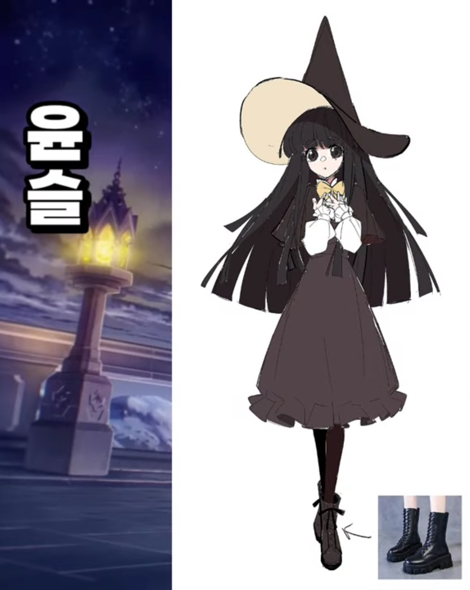
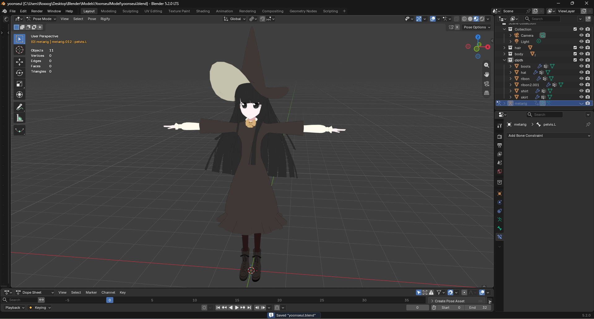

<!-- more -->

<!--
작품 폴더 위치:
site/content/projects/first-blender-project/

이 index.md와 이미지·영상 파일을 같은 폴더에 둡니다.
예: cover.png, final-front.png, final-detail.png, process.mp4
실제 파일명에 맞춰 아래 예시의 파일명도 바꿔 주세요.
-->

## 작업 소개

- 캐릭터를 만들며 블랜더를 배우기 -
캐릭터명 : 윤슬 (좀비고등학교의 AU 시리즈 마법고등학교의 캐릭터)

## 완성 이미지

## 제작 과정

블랜더의 기본기와 캐릭터를 만드는 것을 동시에 진행하며
모델링 -> UV -> 텍스쳐 -> 리깅 -> 애니메이팅
이라는 기본 파이프라인의 개념을 배우며 제작하였다.

## 작업 영상



## 결과와 배운 점

사실은 이 전에 만들던 캐릭터가 하나 있었지만 결국 앞서 말한 파이프라인의 과정을 모두 수행하지 못하고 폐기되어 현재는 기록이 남아있지 않은 캐릭터가 하나 있다.
하지만 실력을 올리는 과정에는 반드시 캐릭터 하나를 완성하는 것이 필요하다는 것을 명심했었다.
그렇게 하여 윤슬이라는 캐릭터는 거의 모든 과정을 끝까지 해낸 첫 캐릭터라고 할 수 있다.
물론 다듬어야 할 부분은 많지만 초기 실력 향상에 있어서 매우 기념비적인 캐릭터이다.